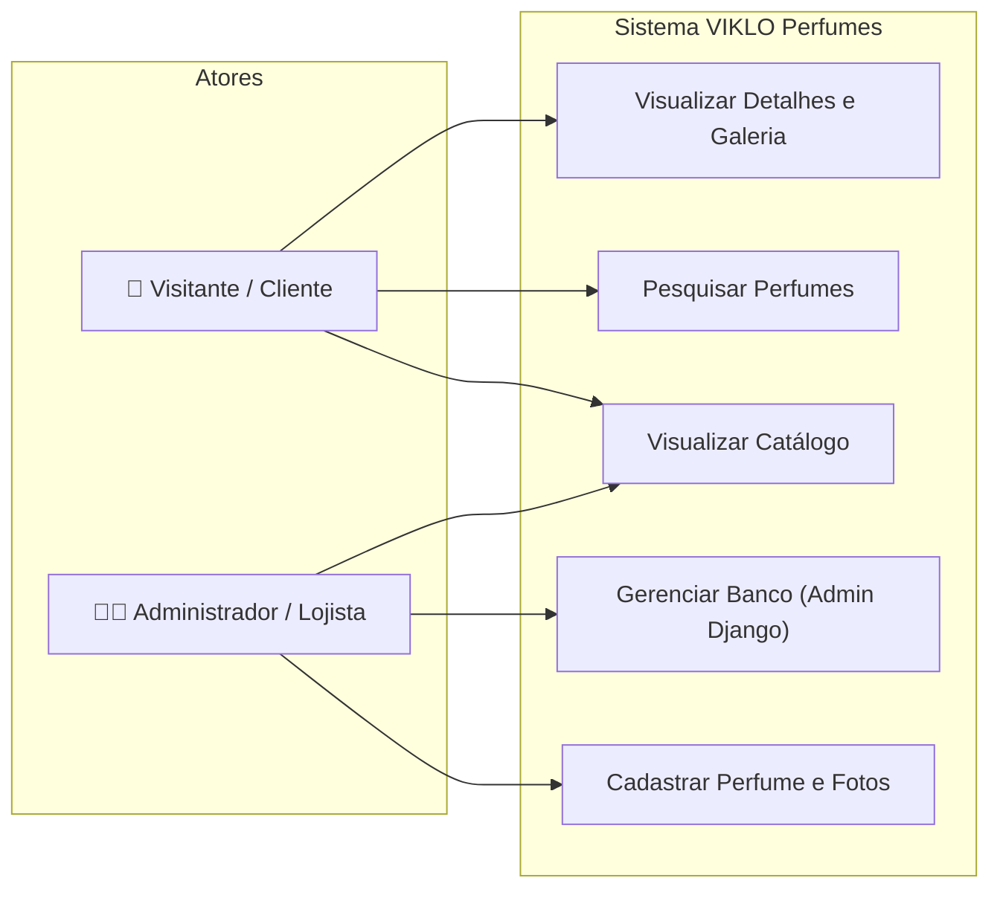
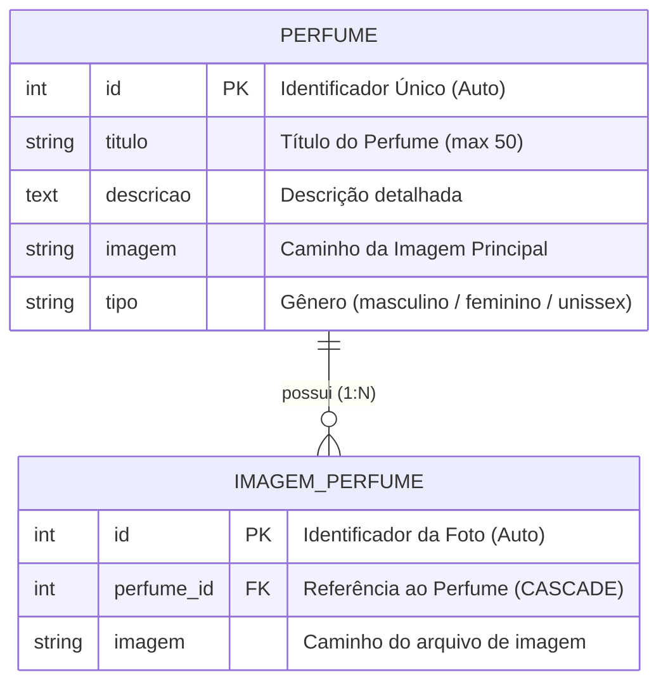

# [NOME DA INSTITUIÇÃO DE ENSINO / ESCOLA TÉCNICA]
## [CURSO TÉCNICO EM DESENVOLVIMENTO DE SISTEMAS / INFORMÁTICA]

<br><br><br>

# VIKLO PERFUMES: SISTEMA WEB PARA CATÁLOGO, BUSCA E GESTÃO DE PRODUTOS DE PERFUMARIA

<br><br><br>

### [NOME DO ALUNO / AUTOR]

<br><br><br><br><br>

**[CIDADE – UF]**  
**2026**

---

<div style="page-break-after: always;"></div>

### [NOME DO ALUNO / AUTOR]

<br><br><br>

# VIKLO PERFUMES: SISTEMA WEB PARA CATÁLOGO, BUSCA E GESTÃO DE PRODUTOS DE PERFUMARIA

<br><br>

<div style="margin-left: 40%; text-align: justify; font-size: 0.95em;">
Trabalho de Conclusão de Curso apresentado como requisito parcial para a obtenção do título de Técnico em Desenvolvimento de Sistemas / Informática integrado ao Ensino Médio na [Nome da Instituição].
<br><br>
<b>Orientador(a):</b> Prof(a). [Nome do Orientador]
</div>

<br><br><br><br><br>

**[CIDADE – UF]**  
**2026**

---

<div style="page-break-after: always;"></div>

## RESUMO

O presente Trabalho de Conclusão de Curso (TCC) apresenta o desenvolvimento do sistema **VIKLO Perfumes**, uma aplicação web voltada à apresentação, busca e gerenciamento de catálogo para produtos do segmento de perfumaria e cosméticos. O mercado contemporâneo exige soluções digitais que ofereçam aos consumidores uma experiência visual imersiva, intuitiva e responsiva, aliada a um painel simples para cadastro de itens e controle administrativo. A aplicação foi concebida utilizando a linguagem **Python** e o framework **Django**, estruturada sob a arquitetura de software **MVT** (*Model-View-Template*), com banco de dados relacional **SQLite** e biblioteca **Pillow** para processamento e validação de arquivos multimídia. No front-end, empregou-se **HTML5**, **CSS3** e o framework **Bootstrap 5**, aplicando uma identidade visual moderna em tema escuro (*Dark Mode*). Entre as principais funcionalidades implementadas, destacam-se a navegação por grade de produtos com paginação dinâmica, mecanismo de busca textual com filtros compostos (*Q objects*), visualização detalhada com suporte a múltiplas imagens por produto em relacionamento 1:N, além de formulário de cadastro com upload múltiplo de arquivos. Os testes realizados atestaram a robustez do fluxo de dados, a responsividade do layout e a integridade referencial do banco de dados, evidenciando o potencial da solução para uso comercial e acadêmico.

**Palavras-chave:** Desenvolvimento Web. Python. Django. Catálogo Digital. Perfumaria. Bootstrap.

---

## ABSTRACT

This final course assignment presents the development of the **VIKLO Perfumes** system, a web application designed for displaying, searching, and managing a product catalog in the fragrance and cosmetics industry. The modern market demands digital solutions providing consumers with an immersive, intuitive, and responsive visual experience, combined with an agile registration and administration module. The application was built using **Python** and the **Django** framework, structured under the **MVT** (*Model-View-Template*) architectural pattern, with **SQLite** as the relational database and the **Pillow** library for image handling. For the front-end, **HTML5**, **CSS3**, and **Bootstrap 5** were utilized, adopting a modern dark-themed visual identity. Key implemented features include responsive catalog navigation with dynamic pagination, text-based search filtering (*Q objects*), detailed product inspection with multi-image gallery support (1:N relationship), and a registration form supporting simultaneous multiple file uploads. Validation tests verified data consistency, cross-device responsiveness, and relational integrity, highlighting the solution's technical viability for both practical and academic purposes.

**Keywords:** Web Development. Python. Django. Digital Catalog. Fragrances. Bootstrap.

---

<div style="page-break-after: always;"></div>

## LISTA DE ABREVIATURAS E SIGLAS

- **ABNT** – Associação Brasileira de Normas Técnicas
- **CSS** – *Cascading Style Sheets*
- **CSRF** – *Cross-Site Request Forgery*
- **DER** – Diagrama de Entidade-Relacionamento
- **FK** – *Foreign Key* (Chave Estrangeira)
- **HTML** – *HyperText Markup Language*
- **HTTP** – *Hypertext Transfer Protocol*
- **MVT** – *Model-View-Template*
- **ORM** – *Object-Relational Mapping*
- **PK** – *Primary Key* (Chave Primária)
- **RF** – Requisito Funcional
- **RNF** – Requisito Não-Funcional
- **SQL** – *Structured Query Language*
- **TCC** – Trabalho de Conclusão de Curso
- **UI** – *User Interface* (Interface do Usuário)
- **UX** – *User Experience* (Experiência do Usuário)

---

<div style="page-break-after: always;"></div>

## SUMÁRIO

1. [1. INTRODUÇÃO](#1-introdução)  
   1.1 [Contextualização](#11-contextualização)  
   1.2 [Problema de Pesquisa](#12-problema-de-pesquisa)  
   1.3 [Justificativa](#13-justificativa)  
   1.4 [Objetivos](#14-objetivos)  
   &nbsp;&nbsp;&nbsp;&nbsp;1.4.1 [Objetivo Geral](#141-objetivo-geral)  
   &nbsp;&nbsp;&nbsp;&nbsp;1.4.2 [Objetivos Específicos](#142-objetivos-específicos)  
2. [2. REFERENCIAL TEÓRICO E TECNOLOGIAS](#2-referencial-teórico-e-tecnologias)  
   2.1 [Linguagem Python e o Framework Django](#21-linguagem-python-e-o-framework-django)  
   2.2 [Padrão Arquitetural MVT](#22-padrão-arquitetural-mvt)  
   2.3 [Front-end e Framework Bootstrap 5](#23-front-end-e-framework-bootstrap-5)  
   2.4 [Persistência de Dados e Mapeamento Objeto-Relacional (ORM)](#24-persistência-de-dados-e-mapeamento-objeto-relacional-orm)  
   2.5 [Manipulação de Mídia com Pillow](#25-manipulação-de-mídia-com-pillow)  
3. [3. LEVANTAMENTO E ANÁLISE DE REQUISITOS](#3-levantamento-e-análise-de-requisitos)  
   3.1 [Requisitos Funcionais (RF)](#31-requisitos-funcionais-rf)  
   3.2 [Requisitos Não-Funcionais (RNF)](#32-requisitos-não-funcionais-rnf)  
   3.3 [Regras de Negócio](#33-regras-de-negócio)  
4. [4. MODELAGEM E ARQUITETURA DO SISTEMA](#4-modelagem-e-arquitetura-do-sistema)  
   4.1 [Diagrama de Casos de Uso](#41-diagrama-de-casos-de-uso)  
   4.2 [Modelo de Dados e Diagrama Entidade-Relacionamento (DER)](#42-modelo-de-dados-e-diagrama-entidade-relacionamento-der)  
   4.3 [Mapeamento e Fluxo de Rotas (URLs)](#43-mapeamento-e-fluxo-de-rotas-urls)  
5. [5. IMPLEMENTAÇÃO E FUNCIONALIDADES DO SISTEMA](#5-implementação-e-funcionalidades-do-sistema)  
   5.1 [Estrutura do Projeto](#51-estrutura-do-projeto)  
   5.2 [Modelagem dos Perfumes e Galeria de Imagens](#52-modelagem-dos-perfumes-e-galeria-de-imagens)  
   5.3 [Módulo de Catálogo, Busca Textual e Paginação](#53-módulo-de-catálogo-busca-textual-e-paginação)  
   5.4 [Página de Detalhes e Apresentação do Produto](#54-página-de-detalhes-e-apresentação-do-produto)  
   5.5 [Módulo de Cadastro e Upload de Arquivos](#55-módulo-de-cadastro-e-upload-de-arquivos)  
   5.6 [Interface com Usuário e Design Visual](#56-interface-com-usuário-e-design-visual)  
6. [6. TESTES E RESULTADOS OBTIDOS](#6-testes-e-resultados-obtidos)  
   6.1 [Testes de Funcionalidade e Integração](#61-testes-de-funcionalidade-e-integração)  
   6.2 [Testes de Responsividade e Interface](#62-testes-de-responsividade-e-interface)  
   6.3 [Discussão dos Resultados](#63-discussão-dos-resultados)  
7. [7. CONSIDERAÇÕES FINAIS E TRABALHOS FUTUROS](#7-considerações-finais-e-trabalhos-futuros)  
   7.1 [Conclusão](#71-conclusão)  
   7.2 [Trabalhos Futuros](#72-trabalhos-futuros)  
8. [REFERÊNCIAS BIBLIOGRÁFICAS](#referências-bibliográficas)  
9. [APÊNDICES](#apêndices)  

---

<div style="page-break-after: always;"></div>

# 1. INTRODUÇÃO

## 1.1 Contextualização
O avanço das tecnologias digitais e o crescimento contínuo do comércio eletrônico transformaram radicalmente os hábitos de consumo. No segmento de perfumaria e cosméticos de luxo, a experiência de compra está intimamente associada à sofisticação visual, à clareza das descrições sensoriais e à facilidade com que o consumidor localiza itens adequados às suas preferências olfativas e de estilo.

Nesse cenário, empresas de todos os portes necessitam de plataformas web ágeis e atrativas que atuem como vitrines virtuais completas. A criação de catálogos digitais otimizados permite estreitar o relacionamento com os clientes, apresentar detalhes minuciosos das fragrâncias (incluindo frasco, notas olfativas e categorização por gênero) e oferecer uma navegação limpa, sem fricções ou barreiras visuais.

## 1.2 Problema de Pesquisa
Muitos pequenos empreendedores ou entusiastas do ramo de perfumaria enfrentam dificuldades ao tentar divulgar seus catálogos de produtos. O uso de redes sociais ou ferramentas estáticas limita a capacidade de busca inteligente, categorização de produtos e visualização estruturada de múltiplas fotografias de cada item. Por outro lado, plataformas comerciais pré-moldadas de e-commerce costumam exigir assinaturas onerosas, taxas por transação e estruturas complexas e pesadas para quem busca, primordialmente, uma vitrine digital sofisticada e dinâmica.

Dessa forma, formula-se o problema: **Como desenvolver uma aplicação web leve, responsiva e de fácil manutenção que permita gerenciar e exibir com sofisticação um catálogo de perfumaria, integrando busca textual, paginação e suporte a múltiplas fotos por produto?**

## 1.3 Justificativa
O desenvolvimento deste projeto justifica-se tanto pelo prisma prático quanto pelo acadêmico. No aspecto prático, a aplicação **VIKLO Perfumes** preenche a lacuna de uma vitrine digital elegante e direta, facilitando a navegação do cliente e o cadastramento rápido por parte dos gestores.

No aspecto acadêmico e formativo do Ensino Médio Técnico, o projeto consolida competências essenciais de engenharia de software e desenvolvimento web full-stack:
- Estruturação de back-end utilizando uma linguagem amplamente adotada no mercado (**Python**) e seu ecossistema mais maduro (**Django**);
- Modelagem de bancos de dados relacionais e implementação de relacionamentos de cardinalidade 1:N;
- Construção de interfaces ricas com **HTML5**, **CSS3** e **Bootstrap 5**, aplicando conceitos modernos de *User Experience* (UX) e design em tema escuro (*Dark Mode*);
- Práticas de modularização, versionamento de código e tratamento seguro de mídias enviadas por usuários.

## 1.4 Objetivos

### 1.4.1 Objetivo Geral
Projetar, implementar e validar um sistema web completo para apresentação de catálogo, busca avançada e gerenciamento de perfumes, denominado **VIKLO Perfumes**, empregando o framework Django e estilização em Bootstrap.

### 1.4.2 Objetivos Específicos
1. Modelar a estrutura de dados relacional para comportar as informações dos perfumes e permitir o vínculo com múltiplas fotos secundárias.
2. Desenvolver o back-end com Django, aplicando o padrão MVT (*Model-View-Template*), controle de rotas dinâmicas e persistência com SQLite.
3. Implementar um mecanismo de busca por palavras-chave com consultas combinadas (`Q objects`) sobre os campos de título e descrição.
4. Integrar o sistema de paginação de registros para otimizar o tempo de resposta e a organização visual das páginas.
5. Elaborar formulário web multipart para cadastro de produtos, com upload simultâneo de foto principal e fotos complementares.
6. Construir um front-end moderno, mobile-first e responsivo, sob estética visual *Dark Theme* condizente com o mercado de perfumaria premium.
7. Realizar testes funcionais e de usabilidade para validação da integridade da aplicação.

---

<div style="page-break-after: always;"></div>

# 2. REFERENCIAL TEÓRICO E TECNOLOGIAS

## 2.1 Linguagem Python e o Framework Django
A linguagem **Python** destaca-se internacionalmente pela sintaxe clara, legibilidade e vasta biblioteca padrão. No desenvolvimento web corporativo e de alto desempenho, o **Django** é amplamente reconhecido como um dos frameworks mais completos, operando sob o lema *"The web framework for perfectionists with deadlines"*.

O Django fornece de forma nativa e integrada:
- Sistema de proteção contra vulnerabilidades web comuns (como *Cross-Site Scripting* - XSS, *Cross-Site Request Forgery* - CSRF e injeção de SQL);
- Painel administrativo autogerado pronto para auditoria e gestão dos dados;
- Sistema de roteamento de URLs baseado em expressões regulares e tipos de dados estritos;
- Mecanismo de templates seguro e desacoplado.

## 2.2 Padrão Arquitetural MVT
Diferente do clássico padrão MVC (*Model-View-Controller*), o Django adota o padrão **MVT** (*Model-View-Template*):
- **Model (Modelo):** Camada de acesso e definição dos dados. Mapeia classes Python em tabelas do banco de dados relacional através do ORM do Django.
- **View (Visão):** Camada responsável pela lógica de negócio e controle da requisição HTTP. Ela busca os dados através dos Models e define qual Template será renderizado em resposta ao cliente.
- **Template (Modelo de Apresentação):** Camada de apresentação em HTML puro ou enriquecido com a sintaxe de tags do Django (*Django Template Language* - DTL), responsável por estruturar a visualização entregue ao navegador do cliente.

```
       Requisição HTTP (Navegador)
                   │
                   ▼
             [ urls.py ] (Mapeamento de Rotas)
                   │
                   ▼
             [ views.py ] (Lógica de Negócio)
              ▲         ▲
              │         │
    Consulta  │         │ Renderização
    de Dados  ▼         ▼ com Contexto
     [ models.py ]  [ templates/ ]
     (SQLite/ORM)    (HTML5/CSS)
```

## 2.3 Front-end e Framework Bootstrap 5
O **Bootstrap 5** é o mais popular framework front-end de código aberto do mundo, voltado para o desenvolvimento responsivo e voltado primariamente para dispositivos móveis (*mobile-first*). Ele disponibiliza uma malha (*grid system*) de 12 colunas flexível baseada em Flexbox, além de uma ampla gama de componentes utilitários (botões, barras de navegação, formulários e cards).

No projeto VIKLO Perfumes, o Bootstrap foi complementado com regras customizadas de CSS para criar uma paleta de cores sofisticada em tons de grafite escuro (`#080b0f`), tipografia refinada e realces em tons elegantes, garantindo que o catálogo transmita uma percepção de exclusividade e luxo.

## 2.4 Persistência de Dados e Mapeamento Objeto-Relacional (ORM)
O Mapeador Objeto-Relacional (**ORM**) do Django abstrai os comandos SQL, permitindo que as consultas e manipulações no banco sejam executadas por meio de métodos e objetos Python. Essa abordagem:
- Elimina o risco de injeções de SQL nas consultas parametrizadas;
- Facilita a portabilidade entre diferentes sistemas de gerenciamento de banco de dados (SGBDs);
- Automatiza as alterações de esquema de banco de dados através das migrações (*migrations*).

O banco de dados empregado neste ambiente de desenvolvimento foi o **SQLite 3**, caracterizado pela portabilidade (*serverless* e baseado em arquivo local único `db.sqlite3`), ideal para fases de homologação e projetos acadêmicos.

## 2.5 Manipulação de Mídia com Pillow
O **Pillow** é a biblioteca de processamento de imagens mais consagrada do ecossistema Python. Integrado ao Django, o Pillow habilita o tipo de campo `models.ImageField`, validando automaticamente se os arquivos enviados nos uploads são de fato imagens autênticas (nos formatos JPEG, PNG, WEBP, etc.), prevenindo falhas de integridade e protegendo o servidor contra o upload indevido de arquivos maliciosos.

---

<div style="page-break-after: always;"></div>

# 3. LEVANTAMENTO E ANÁLISE DE REQUISITOS

## 3.1 Requisitos Funcionais (RF)

| Identificador | Nome do Requisito | Descrição | Prioridade |
| :--- | :--- | :--- | :--- |
| **RF01** | Visualização do Catálogo | O sistema deve listar os perfumes cadastrados em grade organizada com capa, título e prévia. | Essencial |
| **RF02** | Busca por Palavras-chave | O sistema deve permitir pesquisar perfumes pelo título ou por termos contidos na descrição. | Essencial |
| **RF03** | Paginação de Itens | O sistema deve limitar a listagem inicial em 12 itens por página, fornecendo controles de navegação. | Importante |
| **RF04** | Detalhes do Perfume | O sistema deve exibir uma tela dedicada com a descrição completa, classificação (gênero) e galeria de fotos. | Essencial |
| **RF05** | Cadastro de Perfumes | O sistema deve disponibilizar um formulário web com upload de imagem principal e imagens complementares. | Essencial |
| **RF06** | Gestão Administrativa | O sistema deve disponibilizar acesso ao painel administrativo padrão do Django (`/admin`) para controle total. | Importante |

## 3.2 Requisitos Não-Funcionais (RNF)

| Identificador | Categoria | Descrição |
| :--- | :--- | :--- |
| **RNF01** | Usabilidade / Design | A interface deve apresentar tema escuro (*Dark Mode*), layout responsivo e adaptação para celulares e desktops. |
| **RNF02** | Desempenho | O carregamento das páginas do catálogo deve ser veloz, viabilizado pela paginação de 12 registros. |
| **RNF03** | Integridade dos Dados | O banco deve garantir a integridade referencial com exclusão em cascata (`CASCADE`) das imagens secundárias. |
| **RNF04** | Portabilidade | A aplicação deve funcionar com precisão nos principais navegadores modernos (Google Chrome, Mozilla Firefox, Microsoft Edge e Safari). |
| **RNF05** | Segurança | O sistema deve empregar proteção contra ataques CSRF em todos os formulários e uploads de dados. |

## 3.3 Regras de Negócio
- **RN01 – Categorização de Gênero:** Cada perfume deve obrigatoriamente pertencer a uma das três classificações predefinidas: *Masculino*, *Feminino* ou *Unissex* (sendo *Unissex* o valor padrão).
- **RN02 – Exclusão Relacional:** Ao excluir um perfume, todas as fotografias adicionais associadas a ele devem ser removidas automaticamente do banco de dados (deleção em cascata).
- **RN03 – Armazenamento de Arquivos:** Todas as mídias enviadas devem ser salvas no diretório `media/perfumes/` mantendo referências relativas no banco de dados.

---

<div style="page-break-after: always;"></div>

# 4. MODELAGEM E ARQUITETURA DO SISTEMA

## 4.1 Diagrama de Casos de Uso
O sistema atende a dois perfis principais de usuários:
1. **Visitante / Cliente:** Navega pelo catálogo, utiliza a pesquisa por texto, acessa a página individual de detalhes de cada fragrância e visualiza a galeria de imagens.
2. **Administrador / Lojista:** Realiza o cadastramento de novos perfumes, insere imagens de divulgação e gerencia os dados através do painel de controle.



## 4.2 Modelo de Dados e Diagrama Entidade-Relacionamento (DER)
A estrutura relacional foi projetada de forma normalizada para permitir flexibilidade no número de fotos de cada produto:

- **Tabela `Perfume`:** Entidade principal com os dados do item.
- **Tabela `ImagemPerfume`:** Entidade dependente, armazenando múltiplos arquivos vinculados a um único perfume por meio de uma chave estrangeira (*Foreign Key*).



## 4.3 Mapeamento e Fluxo de Rotas (URLs)
As rotas da aplicação foram estruturadas no arquivo `urls.py` de maneira RESTful e intuitiva:

- `GET /` : Redireciona automaticamente o visitante para a rota principal do catálogo.
- `GET /catalogo/` : Carrega o catálogo com suporte a parâmetros de busca (`?q=termo`) e paginação (`?page=numero`).
- `GET /perfume/<int:id>/` : Exibe os detalhes e a galeria fotográfica do perfume com a chave primária correspondente.
- `GET / POST /formulario/` : Exibe a tela de cadastro e processa o envio do formulário com uploads de arquivos multipart.
- `/admin/` : Painel administrativo oficial do Django.
- `/media/` : Servimento de arquivos estáticos de imagem em ambiente de desenvolvimento (`DEBUG=True`).

---

<div style="page-break-after: always;"></div>

# 5. IMPLEMENTAÇÃO E FUNCIONALIDADES DO SISTEMA

## 5.1 Estrutura do Projeto
O projeto foi organizado de forma modular conforme as convenções arquiteturais do Django:

```text
TCC_WEB/
│
├── manage.py                  # Utilitário de linha de comando do Django
├── db.sqlite3                 # Base de dados relacional SQLite
│
├── TCC_WEB/                   # Módulo de configuração global do projeto
│   ├── __init__.py
│   ├── settings.py            # Definições de banco, apps, templates e mídias
│   ├── urls.py                # Roteamento geral de URLs
│   ├── wsgi.py                # Interface de execução WSGI
│   └── asgi.py
│
├── TCC_WEBS/                  # Aplicação principal (App de Perfumes)
│   ├── admin.py               # Configuração do painel administrativo
│   ├── apps.py                # Metadados da aplicação
│   ├── models.py              # Definição das classes Perfume e ImagemPerfume
│   ├── views.py               # Lógica de controle e renderização
│   ├── migrations/            # Histórico de alterações do banco de dados
│   └── templates/             # Arquivos de visualização HTML
│       ├── Catalogo/
│       │   └── Catalogo.html  # Grid de produtos, busca e paginação
│       ├── Detalhes/
│       │   └── Detalhes.html  # Apresentação do produto e galeria
│       └── Formulario/
│           └── Formulario.html# Formulário de inserção com upload
│
└── media/                     # Diretório de persistência de uploads
    └── perfumes/              # Armazenamento das fotos dos perfumes
```

## 5.2 Modelagem dos Perfumes e Galeria de Imagens
No arquivo `TCC_WEBS/models.py`, as entidades foram criadas com classes Python herdando de `models.Model`. A entidade `Perfume` conta com um campo de escolhas (`choices`) para o gênero olfativo. A classe `ImagemPerfume` utiliza o atributo `related_name="imagens"` para viabilizar a busca reversa no ORM:

```python
from django.db import models

class Perfume(models.Model):
    titulo = models.CharField(max_length=50)
    descricao = models.TextField()
    imagem = models.ImageField(upload_to='perfumes/')

    TIPOS_PERFUME = [
        ('masculino', 'Masculino'),
        ('feminino', 'Feminino'),
        ('unissex', 'Unissex'),
    ]

    tipo = models.CharField(
        max_length=20,
        choices=TIPOS_PERFUME,
        default='unissex'
    )

    def __str__(self):
        return self.titulo


class ImagemPerfume(models.Model):
    perfume = models.ForeignKey(
        Perfume,
        on_delete=models.CASCADE,
        related_name="imagens"
    )
    imagem = models.ImageField(upload_to="perfumes/")

    def __str__(self):
        return f"Imagem de {self.perfume.titulo}"
```

## 5.3 Módulo de Catálogo, Busca Textual e Paginação
A função `catalogo(request)` no arquivo `views.py` gerencia o fluxo de exibição e busca. A consulta textual utiliza os operadores `Q` do Django para realizar uma busca lógica `OR` (*ou*) sem distinção de maiúsculas/minúsculas (`icontains`) sobre o título ou a descrição do perfume. Em seguida, a classe `Paginator` fragmenta a lista em lotes de 12 itens por página:

```python
def catalogo(request):
    perfumes = Perfume.objects.all().order_by("id")
    busca = request.GET.get("q", "")

    if busca:
        perfumes = perfumes.filter(
            Q(titulo__icontains=busca) |
            Q(descricao__icontains=busca)
        )

    paginator = Paginator(perfumes, 12)
    numero = request.GET.get("page")
    pagina = paginator.get_page(numero)

    return render(request, "Catalogo/Catalogo.html", {
        "perfumes": pagina.object_list,
        "pagina": pagina,
        "busca": busca,
    })
```

## 5.4 Página de Detalhes e Apresentação do Produto
A função `detalhes_perfume(request, id)` recupera o perfume requisitado através do método utilitário `get_object_or_404()`, garantindo que requisições com identificadores inválidos retornem o código de status HTTP 404 de maneira segura. Além disso, as imagens adicionais são resgatadas pelo relacionamento reverso `perfume.imagens.all()`:

```python
def detalhes_perfume(request, id):
    perfume = get_object_or_404(Perfume, id=id)
    imagens = perfume.imagens.all()

    if perfume.tipo == "masculino":
        genero = "Masculino"
    elif perfume.tipo == "feminino":
        genero = "Feminino"
    else:
        genero = "Unissex"

    return render(request, "Detalhes/Detalhes.html", {
        "perfume": perfume,
        "genero": genero,
        "imagens": imagens,
    })
```

## 5.5 Módulo de Cadastro e Upload de Arquivos
A view `formulario(request)` processa o envio dos dados via método `POST`. Diferenciando campos simples e arquivos de mídia através de `request.FILES`, a rotina primeiro cria a instância principal de `Perfume` e em seguida itera pela lista de imagens complementares obtida com `request.FILES.getlist("imagens")`:

```python
def formulario(request):
    if request.method == "POST":
        titulo = request.POST.get("titulo")
        descricao = request.POST.get("descricao")
        imagem = request.FILES.get("imagem")
        tipo = request.POST.get("tipo")

        # Criação do perfume principal
        perfume = Perfume.objects.create(
            titulo=titulo,
            descricao=descricao,
            imagem=imagem,
            tipo=tipo
        )

        # Recebimento de múltiplas imagens adicionais
        imagens = request.FILES.getlist("imagens")
        for img in imagens:
            ImagemPerfume.objects.create(
                perfume=perfume,
                imagem=img
            )

        return redirect("catalogo")

    return render(request, "Formulario/Formulario.html")
```

## 5.6 Interface com Usuário e Design Visual
O front-end foi projetado para transmitir requinte e modernidade:
- **Barra de Navegação (*Navbar*):** Logotipo com tipografia imponente ("VIKLO PERFUMES"), campo integrado de busca dinâmica e botão direto de acesso para cadastramento de novos itens.
- **Grid de Produtos:** Disposição em cartões (*cards*) estilizados com cantos arredondados, efeitos de transição (*hover*), botão "Ver Detalhes" e badges indicativas do tipo de perfume.
- **Galeria Interativa:** Exibição destacada da imagem principal com miniaturas selecionáveis das imagens complementares, permitindo explorar os detalhes do frasco e da embalagem.

---

<div style="page-break-after: always;"></div>

# 6. TESTES E RESULTADOS OBTIDOS

## 6.1 Testes de Funcionalidade e Integração
Para validar a conformidade da aplicação com os requisitos especificados, foram elaborados e executados cenários de testes manuais cobrindo todo o ciclo operacional do sistema:

| Caso de Teste | Ação Realizada | Resultado Esperado | Resultado Obtido | Situação |
| :--- | :--- | :--- | :--- | :--- |
| **TC-01** | Acessar rota raiz `/` | Redirecionar automaticamente para `/catalogo/` | Redirecionamento 302 executado com sucesso | Aprovado |
| **TC-02** | Pesquisa por termo existente | Filtrar perfumes contendo a palavra no título ou texto | Listagem correta dos produtos correspondentes | Aprovado |
| **TC-03** | Pesquisa por termo inexistente | Exibir tela sem quebras de layout | Mensagem informando ausência de resultados | Aprovado |
| **TC-04** | Cadastrar perfume com 1 foto de capa | Salvar perfume no SQLite e redirecionar | Perfume gravado com sucesso no catálogo | Aprovado |
| **TC-05** | Cadastrar perfume com fotos adicionais | Gravar perfume e n instâncias de `ImagemPerfume` | Registros e arquivos físicos salvos em `media/` | Aprovado |
| **TC-06** | Acessar perfume inexistente `/perfume/9999/` | Retornar página de erro 404 | Tratamento de erro 404 retornado | Aprovado |
| **TC-07** | Paginação com mais de 12 itens | Quebrar resultados e exibir links de páginas | Navegação funcional entre página 1, 2, etc. | Aprovado |

## 6.2 Testes de Responsividade e Interface
A responsividade foi verificada por meio das ferramentas de desenvolvedor (*DevTools*) simulando diferentes resoluções de tela:
- **Mobile (360px a 480px):** O grid organiza-se em coluna única, mantendo espaçamento adequado para toque nos botões e leitura fluida dos textos.
- **Tablet (768px a 1024px):** O catálogo divide-se em 2 ou 3 colunas, garantindo proporção uniforme das imagens.
- **Desktop (1200px ou superior):** O catálogo acomoda 4 colunas confortáveis, com navbar espaçada e navegação ampla.

## 6.3 Discussão dos Resultados
Os testes confirmaram que a arquitetura adotada atende com eficiência e estabilidade às necessidades propostas. A separação clara proporcionada pelo padrão MVT do Django facilitou a manutenção e a legibilidade do código-fonte. O gerenciamento de uploads de mídias comportou-se de forma consistente, gravando os arquivos no disco e armazenando apenas seus caminhos relativos no banco, o que garante a performance e a escalabilidade do sistema.

---

<div style="page-break-after: always;"></div>

# 7. CONSIDERAÇÕES FINAIS E TRABALHOS FUTUROS

## 7.1 Conclusão
O desenvolvimento do sistema **VIKLO Perfumes** permitiu aplicar na prática os princípios de engenharia de software, modelagem de banco de dados e programação full-stack abordados durante o Ensino Médio Técnico.

A escolha do framework Django demonstrou ser altamente acertada, proporcionando produtividade, segurança integrada e facilidade na manipulação do banco de dados relacional por meio do ORM. A integração com Bootstrap 5 garantiu uma experiência visual atraente e alinhada aos padrões visuais de marcas de luxo contemporâneas. Todos os objetivos gerais e específicos delimitados no início do projeto foram integralmente cumpridos com sucesso.

## 7.2 Trabalhos Futuros
Para a evolução do sistema rumo a uma plataforma completa de comércio eletrônico (*e-commerce*), sugerem-se as seguintes melhorias:
1. **Autenticação e Níveis de Acesso:** Implementar sistema de login e cadastro de clientes com separação estrita de perfis (visitante comum vs. administrador de loja).
2. **Carrinho de Compras e Pagamentos:** Adicionar módulo de sacola de compras integrado a APIs de pagamento seguras (ex.: Stripe ou Mercado Pago).
3. **Deploy em Ambiente de Produção:** Hospedar o sistema em provedores de nuvem (como Render, Railway ou AWS) e migrar a base SQLite para o PostgreSQL.
4. **Armazenamento de Mídia em Nuvem:** Integrar o armazenamento das imagens a serviços de Bucket S3 (Amazon S3 ou Cloudinary).
5. **Avaliações e Comentários:** Permitir que os consumidores registrem avaliações em estrelas e comentários sobre a fixação e aroma de cada perfume.

---

<div style="page-break-after: always;"></div>

# REFERÊNCIAS BIBLIOGRÁFICAS

- ALCHIN, Marty. **Pro Django**. 2. ed. Nova Iorque: Apress, 2013.
- BOOTSTRAP. **Bootstrap documentation**. Versão 5.3. Disponível em: <https://getbootstrap.com/docs/5.3/>. Acesso em: 11 nov. 2026.
- DEITEL, Paul; DEITEL, Harvey. **Python: Como Programar**. São Paulo: Pearson Education do Brasil, 2017.
- DJANGO SOFTWARE FOUNDATION. **Django documentation**. Versão 6. Disponível em: <https://docs.djangoproject.com/>. Acesso em: 11 nov. 2026.
- PRESSMAN, Roger S.; MAXIM, Bruce R. **Engenharia de Software: Uma Abordagem Profissional**. 8. ed. Porto Alegre: AMGH Editora, 2016.
- SILBERSCHATZ, Abraham; KORTH, Henry F.; SUDARSHAN, S. **Sistema de Banco de Dados**. 7. ed. Rio de Janeiro: Elsevier, 2020.
- SOMMERVILLE, Ian. **Engenharia de Software**. 10. ed. São Paulo: Pearson Education do Brasil, 2018.

---

<div style="page-break-after: always;"></div>

# APÊNDICES

### APÊNDICE A – Script de Execução e Inicialização do Projeto Local

Para reproduzir o ambiente e executar a aplicação em uma nova máquina, seguem os comandos de terminal:

```bash
# 1. Clonar ou navegar até a pasta do projeto
cd C:\Users\Nikolas\TCC_WEB

# 2. Ativar o ambiente virtual Python
.\ll_web\Scripts\activate

# 3. Aplicar as migrações no banco de dados SQLite
python manage.py migrate

# 4. Iniciar o servidor de desenvolvimento local
python manage.py runserver

# 5. Acessar o sistema no navegador
# Catálogo: http://127.0.0.1:8000/catalogo/
# Painel Admin: http://127.0.0.1:8000/admin/
```

